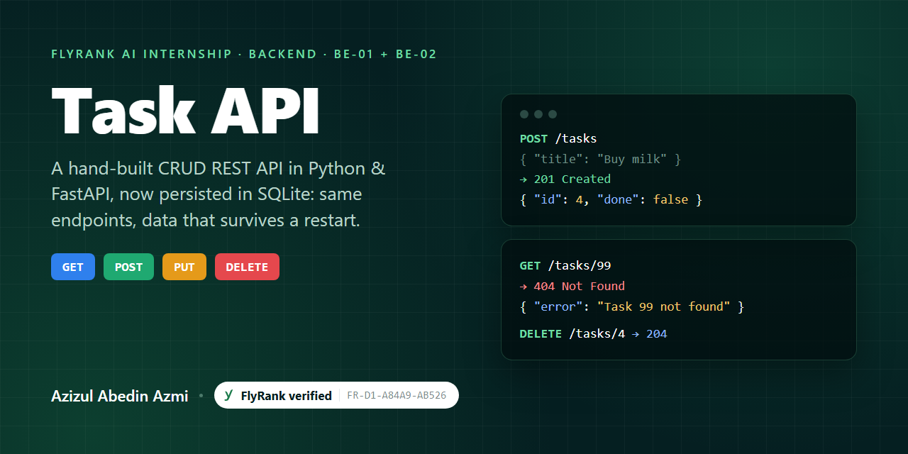
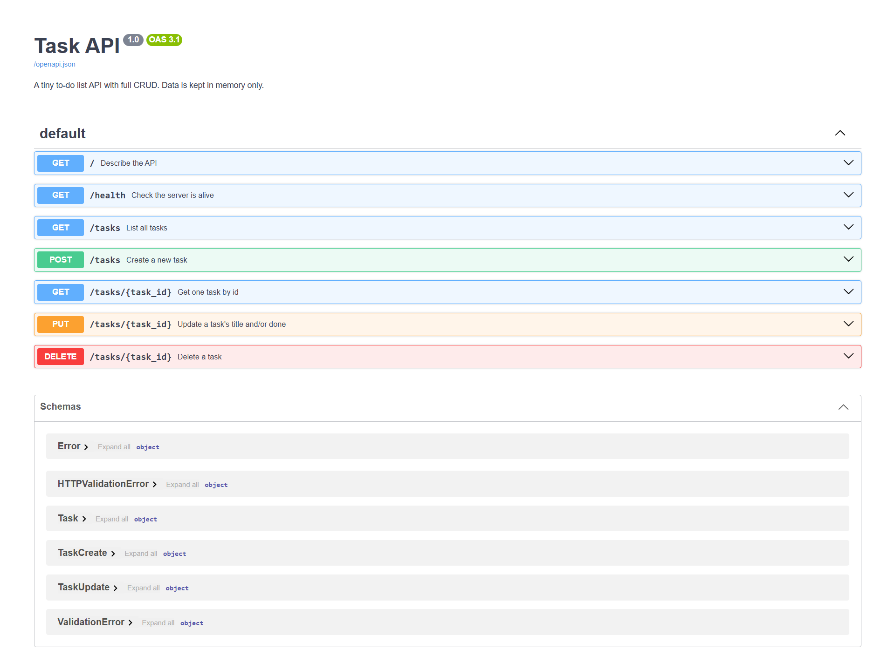
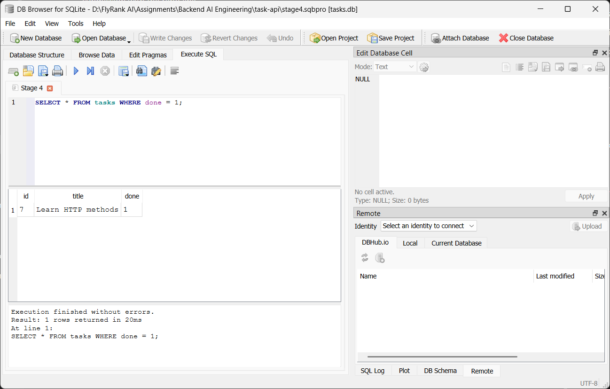

<a name="readme-top"></a>



[](https://www.linkedin.com/in/azizulabedin/)
[](https://github.com/azizulabedinazmi)
[](https://azizulabedinazmi.netlify.app/)
[](https://internship.flyrank.ai/verify?id=FR-D1-A84A9-AB526&first_name=Azizul)
[](https://www.python.org/)
[](https://fastapi.tiangolo.com/)

<div align="center">
  <h3>Task API</h3>
  <p>
    A small to-do list REST API with full CRUD, built by hand with Python and FastAPI.
    Tasks are stored in a SQLite database, so they survive a restart. Every error is JSON, and Swagger UI documents every endpoint.
    <br /><br />
    FlyRank AI Internship · Backend AI Engineering · Week 2 (BE-01: CRUD API) and Week 3 (BE-02: connecting it to a database)
  </p>
</div>

<details>
  <summary>Table of Contents</summary>
  <ol>
    <li><a href="#about-the-project">About The Project</a></li>
    <li><a href="#built-with">Built With</a></li>
    <li><a href="#getting-started">Getting Started</a></li>
    <li><a href="#endpoints">Endpoints</a></li>
    <li><a href="#curl-example">Example: curl -i</a></li>
    <li><a href="#swagger-ui">Swagger UI</a></li>
    <li><a href="#database">The Database (Week 3)</a></li>
    <li><a href="#sql-by-hand">SQL by Hand in DB Browser</a></li>
    <li><a href="#persistence">Persistence and "the API didn't change"</a></li>
    <li><a href="#ai-vs-me-db">AI vs Me (Week 3, Stage 6)</a></li>
    <li><a href="#mortality">The Mortality Experiment (Week 2)</a></li>
    <li><a href="#ai-vs-me">AI vs Me (Week 2, Stage 7)</a></li>
    <li><a href="#repository-structure">Repository Structure</a></li>
    <li><a href="#about-me">About Me</a></li>
    <li><a href="#about-flyrank">About FlyRank</a></li>
    <li><a href="#license">License</a></li>
    <li><a href="#contact">Contact</a></li>
  </ol>
</details>

## 📋 About The Project <a name="about-the-project"></a>

This API manages a to-do list: you can create tasks, read them, update them and delete them. Those are the four
CRUD operations behind almost every backend.

- **Five task endpoints** plus `GET /` (API info), `GET /health` (liveness check) and `GET /stats` (counts done in SQL).
- **Correct status codes:** 200 for reads and updates, 201 for create, 204 for delete, 400 for invalid input, 404 for an unknown id.
- **Strict validation.** The server never trusts the client: empty titles, `{}` updates and `"yes"` instead of `true` are all rejected.
- **SQLite storage (Week 3).** Tasks live in `tasks.db`. The file, the table and three example tasks are created automatically
  on first run, and every query is parameterized.
- **Same API as Week 2.** The 19 checkpoint requests from Week 2 pass unchanged against the database version.
- **Built in stages**, each with its own commit, so `git log` tells the story (Week 2: Stages 0–7, Week 3: Stages 0–5 + extras).

<p align="right">(<a href="#readme-top">back to top</a>)</p>

## 🛠️ Built With <a name="built-with"></a>

- [Python 3.10+](https://www.python.org/)
- [FastAPI](https://fastapi.tiangolo.com/) for routing, validation and the OpenAPI schema
- [Uvicorn](https://www.uvicorn.org/) as the server
- [Pydantic](https://docs.pydantic.dev/) strict types (`StrictStr`, `StrictBool`)
- [SQLite](https://sqlite.org/) through Python's built-in [`sqlite3`](https://docs.python.org/3/library/sqlite3.html) module (no extra install)
- [DB Browser for SQLite](https://sqlitebrowser.org/) to look inside `tasks.db`
- Swagger UI (built into FastAPI) at `/docs`

<p align="right">(<a href="#readme-top">back to top</a>)</p>

## 🎯 Getting Started <a name="getting-started"></a>

You need Python 3.10 or newer.

```bash
git clone https://github.com/azizulabedinazmi/FlyRank_BE-01.git
cd FlyRank_BE-01
python -m venv .venv
```

Activate the virtual environment:

- Windows: `.venv\Scripts\activate`
- macOS / Linux: `source .venv/bin/activate`

Install dependencies and start the server:

```bash
pip install -r requirements.txt
uvicorn main:app --reload
```

The API runs at http://localhost:8000. Swagger UI is at http://localhost:8000/docs.

**No database setup is needed.** On the first start the server creates `tasks.db` next to `main.py`, creates the
`tasks` table and inserts three example tasks. To start over with a fresh database, stop the server, delete
`tasks.db`, and start it again.

<p align="right">(<a href="#readme-top">back to top</a>)</p>

## 🔌 Endpoints <a name="endpoints"></a>

| Method | Path | What it does | Success | Errors |
|--------|------|--------------|---------|--------|
| GET | `/` | Describes the API | 200 | – |
| GET | `/health` | Health check, returns `{"status": "ok"}` | 200 | – |
| GET | `/tasks` | Lists all tasks (optional `?search=`, `?done=`, `?sort=title`) | 200 | 400 bad query value |
| GET | `/tasks/{id}` | Gets one task | 200 | 404 unknown id |
| POST | `/tasks` | Creates a task from `{"title": "..."}` | 201 | 400 missing/empty title |
| PUT | `/tasks/{id}` | Updates `title` and/or `done` | 200 | 400 empty/invalid body, 404 unknown id |
| DELETE | `/tasks/{id}` | Deletes a task (empty body) | 204 | 404 unknown id |
| GET | `/stats` | `{"total", "done", "open"}` counted with SQL `COUNT()` | 200 | – |

Every error returns JSON like `{"error": "Task 99 not found"}`.

A task looks like this:

```json
{ "id": 1, "title": "Learn HTTP methods", "done": true }
```

### Validation rules

- `POST /tasks`: `title` must be present, must be a string, and cannot be empty or only spaces.
- `PUT /tasks/{id}`: send `title`, `done`, or both. `{}` is rejected. `title` cannot be empty, and `done` must be `true` or `false`.
- Malformed JSON, or a non-number id like `/tasks/abc`, also returns 400.

FastAPI normally answers invalid input with **422**. This project replaces that with **400 + `{"error": ...}`** so it
matches the assignment.

<p align="right">(<a href="#readme-top">back to top</a>)</p>

## 💻 Example: `curl -i` <a name="curl-example"></a>

```text
$ curl -i -X POST http://localhost:8000/tasks -H "Content-Type: application/json" -d '{"title":"Buy milk"}'
HTTP/1.1 201 Created
date: Fri, 20 Nov 2026 12:02:41 GMT
server: uvicorn
content-length: 40
content-type: application/json

{"id":4,"title":"Buy milk","done":false}
```

```text
$ curl -i http://localhost:8000/tasks/99
HTTP/1.1 404 Not Found
date: Fri, 20 Nov 2026 12:02:41 GMT
server: uvicorn
content-length: 29
content-type: application/json

{"error":"Task 99 not found"}
```

> On Windows PowerShell, use `curl.exe` instead of `curl`. Pass the JSON body from a file
> (`--data-binary "@body.json"`) because PowerShell mangles the quotes in `-d '{"title":"Buy milk"}'`.

<p align="right">(<a href="#readme-top">back to top</a>)</p>

## 📖 Swagger UI <a name="swagger-ui"></a>

Open http://localhost:8000/docs. Every endpoint is listed, and **Try it out** sends real requests.



<p align="right">(<a href="#readme-top">back to top</a>)</p>

## 🗄️ The Database (Week 3) <a name="database"></a>

```text
Week 2:   Client  ->  API  ->  a Python list in memory
Week 3:   Client  ->  API  ->  SQLite database (tasks.db)
```

The routes, request bodies and responses stayed the same. Only the storage code under them changed.

### Why SQLite

- **Zero setup.** SQLite is a library, not a server. Python ships it as `sqlite3`, so there is nothing to install,
  configure or keep running, and the whole database is one file.
- **It survives restarts.** The data lives on disk, not in the server's memory, which fixes the problem from the
  Week 2 mortality experiment.
- **It's real SQL.** The same `SELECT`, `INSERT`, `UPDATE` and `DELETE` work on PostgreSQL or MySQL later. Moving
  there means changing `get_db()` and a few details, not the API.
- **Right size for this app.** One small API with one writer at a time is the workload SQLite is built for. A big
  multi-server app with many concurrent writers is when you'd move to PostgreSQL.

### Where the database lives

- The file is **`tasks.db`, next to `main.py`** (set `TASKS_DB=/some/other/path.db` to use a different file, which the
  tests do).
- It is **git-ignored** (`.gitignore` has `tasks.db`), so every clone starts with its own fresh database instead of my test data.
- On startup, `init_db()` runs once:
  1. `sqlite3.connect("tasks.db")` creates the file if it doesn't exist.
  2. `CREATE TABLE IF NOT EXISTS tasks (...)` creates the table if it's missing.
  3. `SELECT COUNT(*) FROM tasks`. Only if the count is `0` does it insert the three example tasks, so restarting
     never duplicates them. The count and the inserts run in one transaction, so the seed is all-or-nothing.

### Schema

```sql
CREATE TABLE IF NOT EXISTS tasks (
    id    INTEGER PRIMARY KEY AUTOINCREMENT,  -- SQLite hands out ids
    title TEXT    NOT NULL,
    done  INTEGER NOT NULL DEFAULT 0 CHECK (done IN (0, 1))  -- SQLite has no BOOLEAN; 0/1
);
CREATE INDEX IF NOT EXISTS idx_tasks_done ON tasks (done);
```

- **`done` is stored as `0`/`1`** because SQLite has no boolean type. `row_to_task()` turns it back into `true`/`false`, so
  clients still see JSON booleans, exactly like Week 2.
- **`AUTOINCREMENT` means ids are never reused.** In Week 2 I used `max(id) + 1`, and the AI-vs-me review pointed out that
  deleting the newest task and creating another one gave the old id to a new task. With `AUTOINCREMENT` SQLite remembers
  the highest id it ever handed out (in the `sqlite_sequence` table), so a deleted id stays retired. You can see this
  below: after I deleted every row and the seed ran again, the new tasks got ids 7, 8 and 9, not 1, 2 and 3.
- **The index on `done`** lets `GET /tasks?done=true` and `GET /stats` look up matching rows directly instead of reading
  every row. `EXPLAIN QUERY PLAN SELECT * FROM tasks WHERE done = 1` reports `SEARCH tasks USING INDEX idx_tasks_done (done=?)`.
  (A `LIKE '%milk%'` search can't use an index because the pattern starts with a wildcard, so I didn't index `title`.)

### Every query is parameterized

User input never goes into the SQL text. It is passed separately as `?` parameters:

| Endpoint | SQL |
|---|---|
| `GET /tasks` | `SELECT id, title, done FROM tasks ORDER BY id` |
| `GET /tasks/{id}` | `SELECT id, title, done FROM tasks WHERE id = ?` |
| `POST /tasks` | `INSERT INTO tasks (title, done) VALUES (?, ?)` |
| `PUT /tasks/{id}` | `UPDATE tasks SET title = ?, done = ? WHERE id = ?` |
| `DELETE /tasks/{id}` | `DELETE FROM tasks WHERE id = ?` (0 rows deleted → 404) |
| `GET /tasks?search=milk&done=false` | `... WHERE title LIKE ? ESCAPE '\' AND done = ?` |
| `GET /stats` | `SELECT COUNT(*), COALESCE(SUM(done), 0) FROM tasks` |

`?sort=title` is the one thing a parameter can't do, since column names can't be `?` placeholders. The query parameter
is limited to `id` or `title` (anything else is a 400), and the matching `ORDER BY` text comes from a fixed dictionary
in the code, never from the request.

### Extras

- **Search:** `GET /tasks?search=milk` uses `LIKE`, which is case-insensitive in SQLite. `%` and `_` in the search text are
  escaped, so `?search=100%` finds "100%" literally instead of matching everything.
- **Filter:** `GET /tasks?done=true` or `?done=false`, using `WHERE done = ?`. It combines with search.
- **Sort:** `GET /tasks?sort=title` uses `ORDER BY title COLLATE NOCASE`.
- **Stats:** `GET /stats` returns `{"total": 6, "done": 1, "open": 5}`, counted by SQLite rather than in a Python loop.
- I skipped `created_at`/`updated_at` on purpose: it would add fields to every response, and the point of this week
  was to keep the API exactly the same.

<p align="right">(<a href="#readme-top">back to top</a>)</p>

## 🔍 SQL by Hand in DB Browser <a name="sql-by-hand"></a>

`tasks.db` open in [DB Browser for SQLite](https://sqlitebrowser.org/), **Browse Data** tab. These are the same rows
`GET /tasks` returned at that moment:


The **Execute SQL** tab running `SELECT * FROM tasks WHERE done = 1;` (taken later, after the table had been emptied and
re-seeded, so only the re-seeded "Learn HTTP methods", now id 7, is done):



### The Stage 4 queries

I ran these directly against `tasks.db` while the API server kept running. The full output is in
[`docs/stage4-sql-session.md`](docs/stage4-sql-session.md).

| Query | What came back |
|---|---|
| `SELECT * FROM tasks;` | All 5 rows: the 3 seeded tasks plus "Buy milk" and "Water the plants" |
| `SELECT * FROM tasks WHERE done = 1;` | 2 rows: "Learn HTTP methods" and "Buy milk" |
| `SELECT COUNT(*) FROM tasks;` | `5` |
| `UPDATE tasks SET done = 1;` | 5 rows changed. `GET /tasks` immediately showed every task with `"done": true` |
| `DELETE FROM tasks WHERE done = 1;` | 5 rows deleted. `GET /tasks` immediately returned `[]` |

**Example query:** `SELECT * FROM tasks WHERE done = 1;` returned only the two completed tasks, which are the same two
that showed `"done": true` in `GET /tasks`.

**What I noticed:** the API showed every change instantly with no restart and no syncing, because DB Browser and the
API read the same file. There is one source of truth. After the `DELETE` emptied the table, restarting the server ran the
seed again (the table was empty), and the three example tasks came back with **new ids 7, 8, 9**, because `AUTOINCREMENT`
never reuses ids.

<p align="right">(<a href="#readme-top">back to top</a>)</p>

## ✅ Persistence and "the API didn't change" <a name="persistence"></a>

**Persistence test (Stages 2–3):** I created "Buy milk" and "Water the plants", stopped the server, started it again,
and `GET /tasks` still returned both. For the update/delete checkpoint I created a task (`201`), marked it done with
`PUT` (`200`), **restarted the server**, read it back still `"done": true` (`200`), deleted it (`204`), and deleted it
again (`404`).

```text
$ curl -i -X POST http://localhost:8000/tasks -H "Content-Type: application/json" -d '{"title":"Buy milk"}'
HTTP/1.1 201 Created
content-type: application/json

{"id":4,"title":"Buy milk","done":false}

# stop the server (Ctrl+C), start it again with: uvicorn main:app --reload

$ curl -s http://localhost:8000/tasks
[{"id":1,"title":"Learn HTTP methods","done":true},{"id":2,"title":"Build a CRUD API","done":false},{"id":3,"title":"Push to GitHub","done":false},{"id":4,"title":"Buy milk","done":false},{"id":5,"title":"Water the plants","done":false}]
```

**Same tests, same results.** The Week 2 checkpoint script sends 19 requests: reads, creates, bad bodies, bad JSON, `PUT {}`,
`"yes"` for a boolean, unknown ids, and double deletes. I ran it, unchanged, against the SQLite version on a fresh database:

```text
$ TASKS_DB=/tmp/test.db uvicorn main:app --port 8001
$ python ai-version/checkpoint.py http://127.0.0.1:8001
...
19/19 passed
```

It got the same status codes and the same response bodies as the in-memory version. The tests only talk to the API
over HTTP, so they can't tell where the data is stored. That they pass without a single change shows that storage
really is just an implementation detail behind the API.

<p align="right">(<a href="#readme-top">back to top</a>)</p>

## 🤖 AI vs Me (Week 3, Stage 6) <a name="ai-vs-me-db"></a>

After migrating by hand, I gave an AI assistant (Claude, in a fresh context that saw only my prompt and my Week 2
in-memory `main.py`) the same migration. Its code is kept apart in [`ai-version-db/`](ai-version-db/), and my
`main.py` was not changed.

- `ai-version-db/PROMPT-v1.md` and `ai-version-db/v1/main.py`: my first prompt and the code it produced
- `ai-version-db/PROMPT-v2.md` and `ai-version-db/v2/main.py`: the improved prompt (rematch)
- `ai-version-db/db_checkpoint.py`: 15 checks. It starts the server itself so it can restart it, covers the Stage 0–3
  checkpoints, edits `tasks.db` directly, and runs the full Week 2 suite
  (`python ai-version-db/db_checkpoint.py ai-version-db/v1`)
- `ai-version-db/results-*.md`: the full output for each version

### My prompt (v1)

```text
Here is my to-do list API in Python/FastAPI (main.py attached). Right now it keeps the tasks in a
Python list in memory, so everything is lost when the server restarts.

Move the storage to a SQLite database so the data survives restarts.

- Use Python's built-in sqlite3 module. The database file is tasks.db.
- One table called tasks with columns id (integer primary key), title (text) and done (boolean).
- When the app starts, create the table if it doesn't exist, and insert the 3 example tasks
  only if the table is empty (so they don't get added again on every restart).
- Every endpoint must keep behaving exactly the same as now: same URLs, same request bodies,
  same responses, same status codes (200/201/204, 400 for invalid input, 404 for an unknown id).
- Use parameterized queries (?) everywhere, never build SQL strings from user input.
- Keep everything in one file, main.py.
```

### Results

v1 started on the first try, created `tasks.db`, seeded once, and survived restarts.

| Check | Mine | AI v1 | AI v2 |
|---|---|---|---|
| DB created, table created, seed runs only once | pass | pass | pass |
| Data survives restarts (create, update) | pass | pass | pass |
| Direct SQL edit shows up in the API instantly | pass | pass | pass |
| `done` stored as 0/1, returned as `true`/`false` | pass | pass | pass |
| SQL inside a title stored as plain text | pass | pass | pass |
| Week 2 suite (19 requests) | 19/19 | 19/19 | 19/19 |
| **Deleted id never reused** | pass | **fail**: deleted task 4, the next new task got id 4 again ❌ | pass |
| `done = 'no'` written by hand in DB Browser | **rejected** by `CHECK` | **accepted**, and the API shows it as `true` ❌ | rejected |
| **Score** | **15/15** | **14/15** | **15/15** |

### 1. What the AI did better

- **A cleaner connection helper.** v1's `get_db()` is a `@contextmanager` that commits on success, rolls back on an
  error and **always closes** the connection, all in one `with get_db() as conn:`. I needed
  `with closing(get_db()) as conn, conn:` to get the same result, because `sqlite3`'s own `with conn:` only commits and
  never closes. That's a trap I can now explain: an unclosed connection kept `tasks.db` locked on Windows while I was
  writing my test script.
- **The database path doesn't depend on where you start the server.** It used `Path(__file__).with_name("tasks.db")`,
  the same idea as mine, without being asked.
- **It kept everything else identical**, including my error messages, the 400 handler and the OpenAPI cleanup, so the
  Week 2 suite passed untouched.

### 2. What it got wrong or quietly ignored

- **Ids get reused.** It used `INTEGER PRIMARY KEY` without `AUTOINCREMENT`, so SQLite hands out `max(id) + 1`. Delete the
  newest task and the next one gets its id. That's exactly the bug the Week 2 AI review taught me to avoid, and the
  migration quietly brought it back.
- **`done BOOLEAN` with no constraint.** SQLite has no real boolean type, so the column accepts anything. I wrote
  `done = 'no'` straight into the table and the API returned `"done": true`, because `bool('no')` is `True`. My
  `CHECK (done IN (0, 1))` makes the database itself refuse it.
- **It returns a dict it built in Python, not the row.** After `INSERT`/`UPDATE` it echoes its own values instead of
  reading the row back. That's fine today, but defaults or triggers in the database would never show up in the response.
- **There's no way to point it at a test database**, so testing it means deleting the real `tasks.db`.

### 3. What my prompt forgot to specify (the AI decided for me)

- **The schema details:** "id (integer primary key)" and "done (boolean)" were all I wrote, and the AI took me literally.
  I never said ids must not be reused, or that `done` must be limited to 0/1.
- **Where `tasks.db` lives** and how to override it for tests.
- **Transactions and closing connections:** I didn't ask. It happened to handle both well in v1.
- **Whether to read rows back after a write.**

### Rematch (v2)

[`PROMPT-v2.md`](ai-version-db/PROMPT-v2.md) spelled out the exact `CREATE TABLE` (with `AUTOINCREMENT`,
`CHECK (done IN (0, 1))` and `NOT NULL`), "next to main.py, or `TASKS_DB` if set", one transaction for the seed, closing
connections, and reading rows back after writes. The new code passed **15/15**. It went further than mine on transactions:
it opens connections in autocommit mode and wraps the seed in an explicit `BEGIN IMMEDIATE`, which locks the database
before the `COUNT`. That way two servers starting at the same moment can't both see an empty table and seed twice.

**Lesson:** the AI's first try ran, persisted, and passed every API test, and it still had two schema bugs that only
show up when you delete the newest task or open the database by hand. I only knew to test for them because I had made
the same decisions myself first.

<p align="right">(<a href="#readme-top">back to top</a>)</p>

## 🧪 The Mortality Experiment (Week 2) <a name="mortality"></a>

I created a task (`id 4`, "Buy milk"), restarted the server, and called `GET /tasks` again. Only the 3 starting
tasks came back. The task list is a Python variable in the server's memory, so it is rebuilt from the source code
every time the program starts, and anything added while it ran is gone. A database keeps data outside the
process, which is the problem Week 3 solves.

**Week 3 rerun:** same experiment against the SQLite version. "Buy milk" was still there after the restart.

<p align="right">(<a href="#readme-top">back to top</a>)</p>

## 🤖 AI vs Me (Week 2, Stage 7) <a name="ai-vs-me"></a>

I gave an AI assistant (Claude) a prompt asking for the same API, ran its code, and fired the same checkpoint
requests at it as at mine. The AI's code is kept apart in [`ai-version/`](ai-version/), and my own `main.py` was
not changed.

- `ai-version/PROMPT-v1.md` and `ai-version/v1/main.py`: first prompt and the code it produced
- `ai-version/PROMPT-v2.md` and `ai-version/v2/main.py`: the improved prompt (rematch)
- `ai-version/checkpoint.py`: the 19 test requests (`python ai-version/checkpoint.py http://127.0.0.1:8000`)
- `ai-version/results-*.md`: the full test output for each version

### My prompt (v1)

```text
Build me a to-do list REST API in Python using FastAPI.

- Keep the tasks in memory in a Python list (no database, no files). Start with 3 example tasks.
- Each task has an id (number), a title (text) and done (true/false).
- Endpoints:
  - GET / returns a short JSON description of the API
  - GET /health returns {"status": "ok"}
  - GET /tasks returns all tasks
  - GET /tasks/{id} returns one task
  - POST /tasks creates a task from {"title": "..."}; the server picks the next id and sets done to false
  - PUT /tasks/{id} updates the title and/or done
  - DELETE /tasks/{id} deletes a task
- Status codes: 200 for reads and updates, 201 for create, 204 for delete, 404 if the id doesn't exist, 400 if the title is missing or empty.
- Errors should be returned as JSON.
- I want Swagger UI at /docs.
- Put everything in one file called main.py.
```

### Results

v1 started on the first try with no extra packages.

| Test | Mine | AI v1 | AI v2 |
|---|---|---|---|
| Reads, create, delete, unknown id (11 tests) | all pass | all pass | all pass |
| `POST {}`, empty or blank title, number title, bad JSON | 400 | 400 | 400 |
| `PUT {}` (empty body) | **400** | **200**, silently changes nothing ❌ | 400 |
| `PUT {"done": "yes"}` | **400** | **200**, stores `done: true` ❌ | 400 |
| `PUT {"done": 1}` | 400 | 200, stores `done: true` ❌ | 400 |
| `GET /tasks/abc` | 400 | 400 | 400 |
| 422 listed in Swagger docs | no | **yes, 4 times** (never actually sent) ❌ | no |
| **Score** | **19/19** | **17/19** | **19/19** |

### 1. What the AI did better

- **Ids are never reused.** v1 uses a `next_id` counter. Mine uses `max(id) + 1`, so if I delete the newest task
  (id 4) and create another, the new one gets id 4 again. A client that still remembers the old task 4 would
  silently get a different task. The counter is the safer design, and I can explain why.
- **Errors use exceptions.** The AI raises `HTTPException(404, ...)` inside a helper and converts it to
  `{"error": ...}` once, in a global handler. In my code, every endpoint has to check `if task is None: return not_found(...)`.
  Its approach means less repeated code.
- **It tells "not sent" apart from "sent as null".** It uses `payload.model_fields_set`, so `{"title": null}` is
  rejected, not ignored.

### 2. What it got wrong or quietly ignored

- **`PUT {}` returns 200 and does nothing.** Accepting an empty update hides client bugs. My API returns 400.
- **`done` is coerced.** Pydantic's default "lax" mode turns `"yes"` and `1` into `true`. I used
  `StrictBool`/`StrictStr` so that only real JSON booleans and strings are accepted.
- **The docs don't match the API.** Swagger still lists a 422 "Validation Error" response on 4 endpoints, but the
  API returns 400 instead. Documentation that lies is worse than none.
- **The error shape is inconsistent.** Most errors are `{"error": "..."}`, but validation errors add an extra
  `details` list.

### 3. What my prompt forgot to specify (the AI decided for me)

- **The exact error body.** I only wrote "errors as JSON". The AI happened to choose `{"error": ...}`, but it could
  just as easily have used FastAPI's default `{"detail": ...}`.
- **What PUT does with an empty body**, and **whether types are strict**. I didn't say, so it picked the lenient option.
- **Malformed JSON and non-numeric ids.** I never mentioned them. The AI chose 400 on its own, which happens to match mine.
- **Id reuse, the exact `GET /` response, the port, and the sample tasks.** All were left to the AI.

### Rematch (v2)

[`PROMPT-v2.md`](ai-version/PROMPT-v2.md) spelled out the exact error shape, "`PUT {}` is a 400", "no type coercion",
"never use 422, and do not list it in the docs", and "ids are never reused". The new code passed 19/19. The cost
was size: v2 is 256 lines against my 139, because it reads the raw request and validates by hand instead of using
Pydantic models, so it also had to describe the request bodies in the OpenAPI docs by hand.

**Lesson:** the AI didn't guess wrong at random. Every failure in v1 traced back to something my prompt didn't say.
I could only spot those failures because I had built and tested the API myself first.

<p align="right">(<a href="#readme-top">back to top</a>)</p>

## 🗂️ Repository Structure <a name="repository-structure"></a>

| Path | Purpose |
|---|---|
| `main.py` | The whole API: routes, validation, and the SQLite storage layer (`get_db`, `init_db`). |
| `tasks.db` | The SQLite database. Created on first run, not committed (see `.gitignore`). |
| `requirements.txt` | Pinned `fastapi` and `uvicorn` versions (`sqlite3` is built into Python). |
| `docs/` | README screenshots (Swagger, DB Browser), the Stage 4 SQL log, and the repo banner (`banner.png`, made from `banner.html`). |
| `ai-version/` | Week 2, Stage 7: the AI-generated in-memory API (v1, v2), both prompts, the test script and the results. |
| `ai-version-db/` | Week 3, Stage 6: the AI-generated SQLite migration (v1, v2), both prompts, the starting in-memory file, the DB checkpoint script and the results. |
| `LICENSE` | MIT License. |
| `README.md` | This file. |

<p align="right">(<a href="#readme-top">back to top</a>)</p>

## 👋 About Me <a name="about-me"></a>

I'm **Azizul Abedin Azmi**, a Computer Science and Engineering graduate from East West University (2026) and a
**Machine Learning Intern at FlyRank AI** (remote).

My main work is **self-supervised computer vision**: image classifiers built on self-supervised Vision Transformers
(SimCLR variants, BYOL, ViT) that need fewer labeled examples, for areas like medical imaging and agriculture.
This repo is part of the backend side of my internship: learning to serve and expose the systems I build.

**Peer-reviewed publications**

- *Detection of Cleft and Non-Cleft Lip Features with a Multi-Task Image Processing Network.* ICCIIR 2025, Springer LNNS vol. 1593. [DOI](https://link.springer.com/chapter/10.1007/978-3-032-02790-0_9)
- *PotatoCare: A Deep Learning-Powered Framework for Automated Detection and Classification of Potato Disease.* ICDSIS 2025, IEEE. [DOI](https://ieeexplore.ieee.org/document/11070388/)
- *A Vision Transformer Adaptation of SimCLRv2 for Self-Supervised Galaxy Detection.* SPICSCON 2025, IEEE. [DOI](https://ieeexplore.ieee.org/document/11504180/)

**Selected projects**

- [E-waste Detection System](https://github.com/azizulabedinazmi/E-waste-Detection-System): real-time YOLOv8 detection in a Gradio app
- [Crop Classification System](https://github.com/azizulabedinazmi/Crop-Classification-GradioApp): Vision Transformer classifier as a Gradio app
- [Image Caption Generator](https://github.com/azizulabedinazmi/Image-Caption-Generator-ICG): InceptionV3 + Transformer trained on COCO, served with Streamlit
- [RMP Classification Models](https://huggingface.co/spaces/azizulabedinazmi/RMP-Classification-System): self-supervised ViT models for rare medicinal plants

More about me: [Portfolio](https://azizulabedinazmi.netlify.app/) ·
[ORCID](https://orcid.org/0009-0003-5269-6900) ·
[ResearchGate](https://www.researchgate.net/profile/Azizul-Abedin-Azmi)

<p align="right">(<a href="#readme-top">back to top</a>)</p>

## 🚀 About FlyRank <a name="about-flyrank"></a>

[FlyRank AI](https://www.flyrank.ai/) is an AI search growth platform. It helps brands rank on Google and become
the trusted answer across AI engines.

The [FlyRank AI Internship](https://internship.flyrank.ai/) is a free, remote, self-paced program built around real
work, expert feedback and verifiable credentials. It has six tracks: General AI Fluency, Machine Learning,
AI Marketing, Front-end AI Engineering, Backend AI Engineering, and UI/UX Design. This project covers assignments
**BE-01** (Build your first CRUD API) and **BE-02** (Connecting your CRUD to the database) of the Backend AI Engineering track.

My internship credential can be checked here:

[](https://internship.flyrank.ai/verify?id=FR-D1-A84A9-AB526&first_name=Azizul)

<p align="right">(<a href="#readme-top">back to top</a>)</p>

## 📜 License <a name="license"></a>

Distributed under the MIT License. See `LICENSE` for more information.

<p align="right">(<a href="#readme-top">back to top</a>)</p>

## 📧 Contact <a name="contact"></a>

Azizul Abedin Azmi · [LinkedIn](https://www.linkedin.com/in/azizulabedin/) · [Portfolio](https://azizulabedinazmi.netlify.app/)

Project Link: [https://github.com/azizulabedinazmi/FlyRank_BE-01](https://github.com/azizulabedinazmi/FlyRank_BE-01)

<p align="right">(<a href="#readme-top">back to top</a>)</p>
