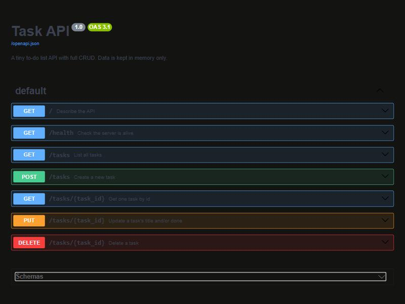

# Task API

A small to-do list API built with **Python + FastAPI**. It supports the four CRUD operations
(create, read, update, delete) on tasks and has interactive documentation through Swagger UI.

Tasks are kept **in memory** (a Python list). There is no database, so all changes are lost
when the server stops.

FlyRank Internship · Backend Track · Week 2 · Assignment A1 (BE-01)

## Run it

You need Python 3.10 or newer.

```bash
git clone https://github.com/azizulabedinazmi/FlyRank_BE-01.git
cd FlyRank_BE-01
python -m venv .venv
```

Activate the virtual environment:

- Windows: `.venv\Scripts\activate`
- macOS / Linux: `source .venv/bin/activate`

Install dependencies and start the server:

```bash
pip install -r requirements.txt
uvicorn main:app --reload
```

The API runs at http://localhost:8000. Swagger UI is at http://localhost:8000/docs.

## Endpoints

| Method | Path | What it does | Success | Errors |
|--------|------|--------------|---------|--------|
| GET | `/` | Describes the API | 200 | – |
| GET | `/health` | Health check, returns `{"status": "ok"}` | 200 | – |
| GET | `/tasks` | Lists all tasks | 200 | – |
| GET | `/tasks/{id}` | Gets one task | 200 | 404 unknown id |
| POST | `/tasks` | Creates a task from `{"title": "..."}` | 201 | 400 missing/empty title |
| PUT | `/tasks/{id}` | Updates `title` and/or `done` | 200 | 400 empty/invalid body, 404 unknown id |
| DELETE | `/tasks/{id}` | Deletes a task (empty body) | 204 | 404 unknown id |

Every error returns JSON like `{"error": "Task 99 not found"}`.

A task looks like this:

```json
{ "id": 1, "title": "Learn HTTP methods", "done": true }
```

### Validation rules

- `POST /tasks`: `title` must be present, must be a string, and cannot be empty or only spaces.
- `PUT /tasks/{id}`: send `title`, `done`, or both. `{}` is rejected. `title` cannot be empty, and `done` must be `true` or `false`.
- Malformed JSON, or a non-number id like `/tasks/abc`, also returns 400.

FastAPI normally answers invalid input with **422**. This project replaces that with **400 + `{"error": ...}`** so it
matches the assignment.

## Example: `curl -i`

```text
$ curl -i -X POST http://localhost:8000/tasks -H "Content-Type: application/json" -d '{"title":"Buy milk"}'
HTTP/1.1 201 Created
date: Fri, 20 Nov 2026 12:02:41 GMT
server: uvicorn
content-length: 40
content-type: application/json

{"id":4,"title":"Buy milk","done":false}
```

```text
$ curl -i http://localhost:8000/tasks/99
HTTP/1.1 404 Not Found
date: Fri, 20 Nov 2026 12:02:41 GMT
server: uvicorn
content-length: 29
content-type: application/json

{"error":"Task 99 not found"}
```

> On Windows PowerShell, use `curl.exe` instead of `curl`. Pass the JSON body from a file
> (`--data-binary "@body.json"`) because PowerShell mangles the quotes in `-d '{"title":"Buy milk"}'`.

## Swagger UI

Open http://localhost:8000/docs. Every endpoint is listed, and **Try it out** sends real requests.



## The mortality experiment

I created a task (`id 4`, "Buy milk"), restarted the server, and called `GET /tasks` again. Only the 3 starting
tasks came back. The task list is a Python variable in the server's memory, so it is rebuilt from the source code
every time the program starts, and anything added while it ran is gone. A database keeps data outside the
process, which is the problem Week 3 solves.

## Project structure

```
FlyRank_BE-01/
├── main.py            # the whole API
├── requirements.txt   # fastapi + uvicorn
├── docs/              # README screenshots
└── README.md
```
